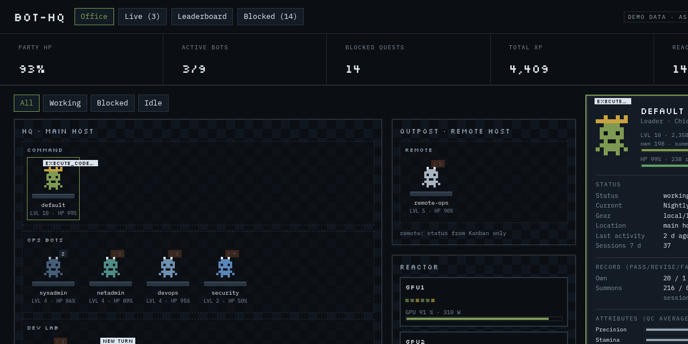

# Bot-HQ — a gamified HQ for your Hermes bot fleet



Bot-HQ is a [Hermes Agent](https://github.com/NousResearch/hermes-agent) desktop plugin that turns your
fleet of Hermes profiles into a pixel-art headquarters: every bot is a sprite at a desk, earns **XP and
levels** from your quality reviews, keeps **HP** from its pass rate, and shows what it is doing **right
now**. Blocked Kanban cards get a triage board with one-click actions, and your GPU/LLM serving stack
shows up as the **reactor**.

It is a read-only mirror of data Hermes already has — sessions, the Kanban boards, a quality ledger,
Prometheus — rendered as a game. The only writes are the Kanban actions you explicitly confirm.

## Views

| Office | Live |
|---|---|
|  |  |
| **Leaderboard** | **Blocked** |
|  |  |

- **Office** — rooms and zones from your roster (main host, outposts, quarantine for untrusted models), a
  sprite per profile with a speech bubble showing its current step, a character card (level, XP, HP,
  attributes, open quests, achievements) and the event log.
- **Live** — what every bot is doing *right now*: active sessions with the current step
  (`terminal command running (42s)`, `receiving stream response`, …), the last tool call and its
  argument, token/cost counters, sub-agents nested under their parent session, running Kanban cards with
  heartbeat age. Stuck steps (no progress for 5 min) turn red. Polled every 10 s while the page is open.
- **Leaderboard** — rank by level, XP, HP or blocked cards; pass/revise/fail record, status, current quest,
  model.
- **Blocked** — every blocked Kanban card across all boards, filed into *waiting for you*, *technically
  stuck*, *stale*, *no reason* and *waiting upstream*, with reason, age, last comment and upstream cards.
  Actions per category: **Answer & unblock** (your answer becomes the unblock reason the bot continues
  with), **Retry**, **Comment**, **Archive** (workspace backed up first). A **Triage run** button opens a
  new chat with your orchestrator profile that reviews the selected cards and hands you one decision
  package — nothing is changed without your go.
- **Reactor** — GPU utilisation/power per node (DCGM) and serving metrics (decode/prefill tok/s, running /
  waiting requests, KV-cache, speculative-decoding acceptance, TTFT) from any vLLM-style metric family.

## Game rules

| | |
|---|---|
| XP | pass +10 · revise +3 · fail −5 (configurable) |
| Level | `1 + floor(sqrt(XP / 25))` |
| HP | pass rate over all reviews |
| Attributes | Precision / Stamina / Discipline / Wisdom = average correctness / completeness / format / safety |
| Summons | sub-agents and helpers count for the bot that spawned them (ledger field `parent`) |
| Achievements | Centurion (100+ passes), Clean record, Summoner, Mirage (hallucinated references), Gridlock, Battered |

XP comes from a **quality ledger**: one JSON line per reviewed delegated answer (`agent`, `verdict`
pass/revise/fail, `dims` correctness/completeness/format/safety 1–5, optional `parent`). If you do not keep
one yet, Bot-HQ still works — everyone starts at level 1 and the live, Kanban and reactor views carry the
page. See `docs/ledger.md` for the format.

## Install

```bash
hermes plugins install W4-NERF/hermes-bot-hq      # or from the Hermes plugin catalog: hermes plugins install bot-hq
hermes plugins enable bot-hq
```

Then **restart the Hermes desktop app once** (the backend routes mount at start) and open **Bot-HQ** in the
sidebar or via ⌘K → *Open Bot-HQ*. If you run Hermes with profiles, enable the plugin in the root home
(the desktop backend runs there) and in any profile that should see it:
`hermes -p <profile> plugins enable bot-hq`.

### Configure

Site-specific settings live outside the plugin so updates never touch them:

```
~/.hermes/plugin-data/bot-hq/config.json   # copy from bothq/config.example.json
~/.hermes/plugin-data/bot-hq/roster.json   # copy from bothq/roster.example.json
```

- `roster.json` — rooms, zones and one entry per bot (role, character class, colour, `leader`, `remote`).
  Profiles missing from the roster are added automatically as *Recruits*.
- `config.json` — locale/timezone, `operator_name` (author of comments you write from the UI),
  `orchestrator_profile` (writes the ledger, receives triage runs), `ledger_path`, `exclude_boards`,
  keywords that file a blocked card under *waiting for you*, XP values, and the `gpu` block
  (`prometheus_url`, `metrics_prefix` `vllm|tensorfold|sglang`, `node_aliases`, `model_endpoint`).
  Leave `prometheus_url` empty to hide the reactor.

Changes to config, roster, collector or UI apply on the next refresh — no restart.

### Try it without a fleet

```bash
python3 bothq/render.py --demo && xdg-open dist/bot-hq.html   # synthetic data, every view
python3 bothq/render.py        && xdg-open dist/bot-hq.html   # your real data as a static page
```

## What it reads and does (disclosure)

- **Reads** (read-only, local): each profile's `state.db` (sessions, last activity, last tool call),
  `~/.hermes/kanban/boards/*/kanban.db` (cards, events, comments), the quality ledger, `hermes profile list`.
- **Network**: only the Prometheus and model endpoints you configure (none by default).
- **Writes**, only on your confirmed click, and only through the official CLI `hermes kanban --board … comment |
  unblock | archive`: never into the database, never `archive --rm`. Every action is appended to
  `var/actions.jsonl`; archiving copies the card's workspace to `var/archived-workspaces/` first.
- **Triage run**: creates a new chat session with your orchestrator profile and submits a briefing that
  contains only card keys (board/id) — never card text — so untrusted card content cannot steer the prompt.
- No telemetry, no self-update, no credentials. Untrusted text (card titles, session titles, tool
  arguments) is escaped before rendering; the UI runs in a sandboxed iframe.

## Layout

```
plugin.yaml           manifest (no tools/hooks)
__init__.py           no-op register()
dashboard/            backend: /api/plugins/bot-hq/{snapshot,live,page,blocker/action}
desktop/plugin.js     desktop page /bot-hq (SandboxedFrame + postMessage)
bothq/collect.py      snapshot collector (read-only)
bothq/live.py         "what is everyone doing" (10-s polling)
bothq/actions.py      Kanban actions via the hermes CLI (category whitelist, audit log)
bothq/blockers.py     blocked-card details for a triage chat
bothq/ui.html         the whole UI, one file, no build step
bothq/demo.py         synthetic data
```

## Development

Link a checkout and the desktop app hot-reloads the UI; only `dashboard/plugin_api.py` needs an app restart:

```bash
ln -s ~/src/hermes-bot-hq ~/.hermes/plugins/bot-hq
hermes plugins enable bot-hq
hermes plugins validate ~/src/hermes-bot-hq --install-deps   # the catalog check
```

Test Kanban actions only against a dedicated sandbox board whose cards have no assignee, and list it in
`exclude_boards`.

## License

MIT — see `LICENSE`. Bundled fonts IBM Plex Mono and Silkscreen are under the SIL Open Font License 1.1
(`bothq/fonts/OFL-*.txt`).
