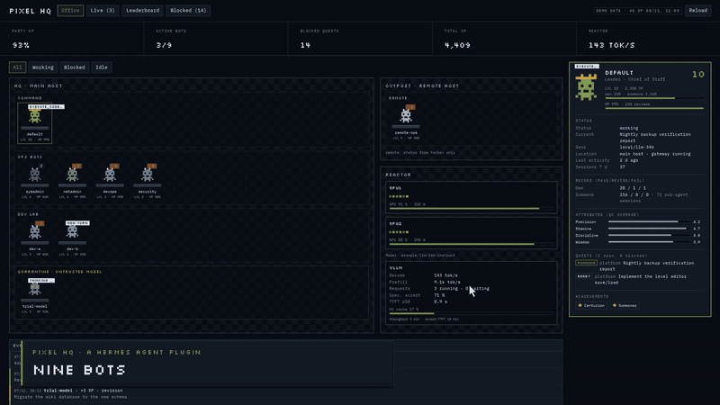
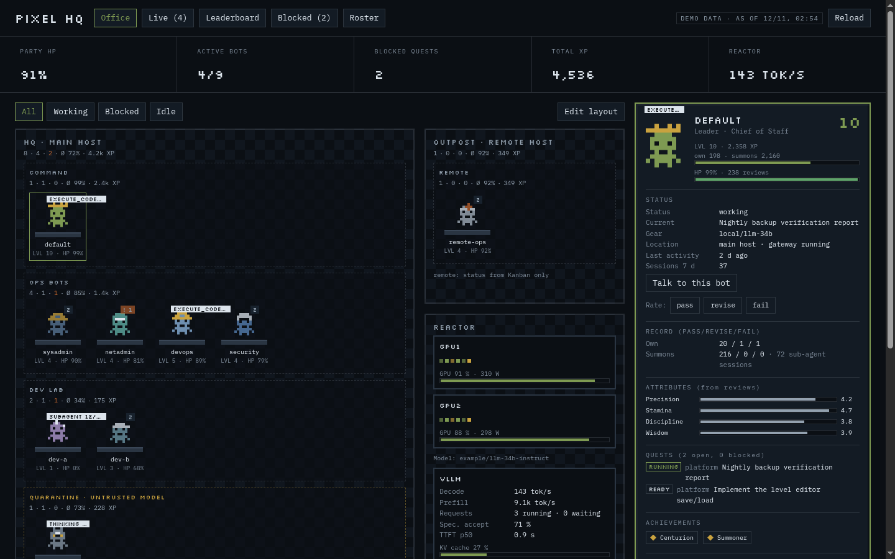
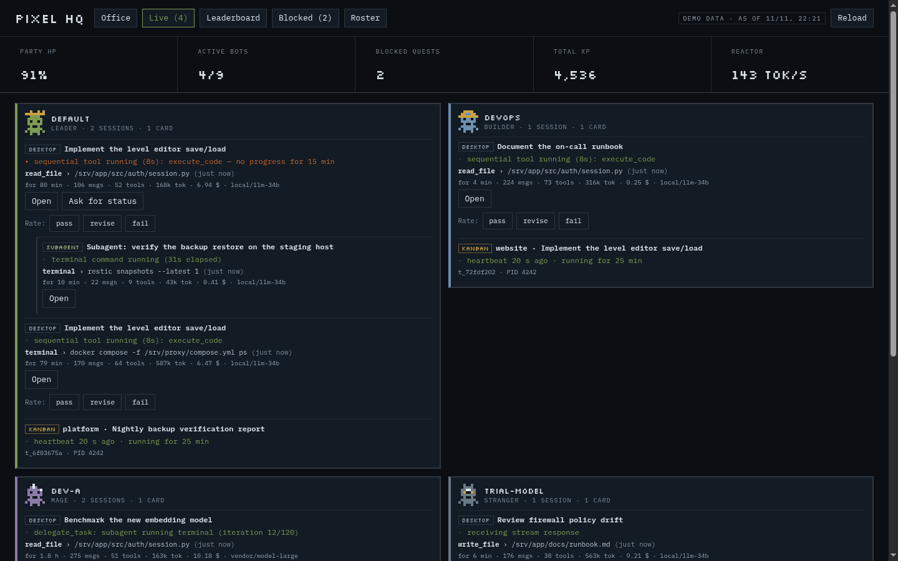
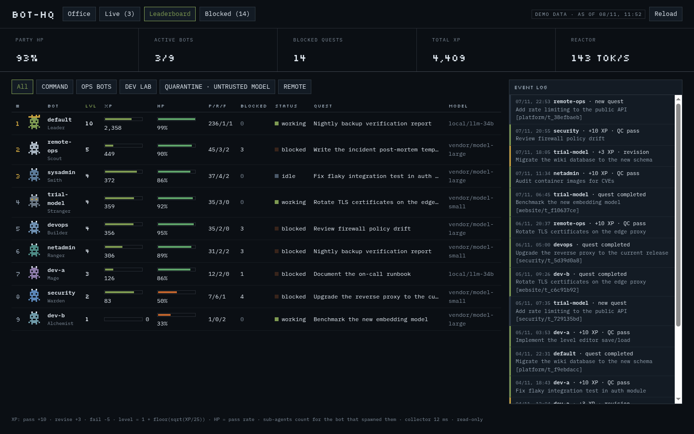
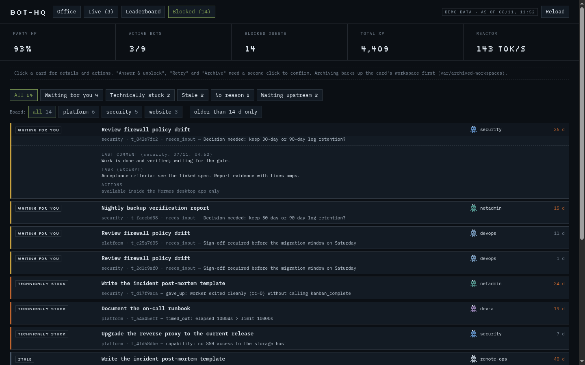
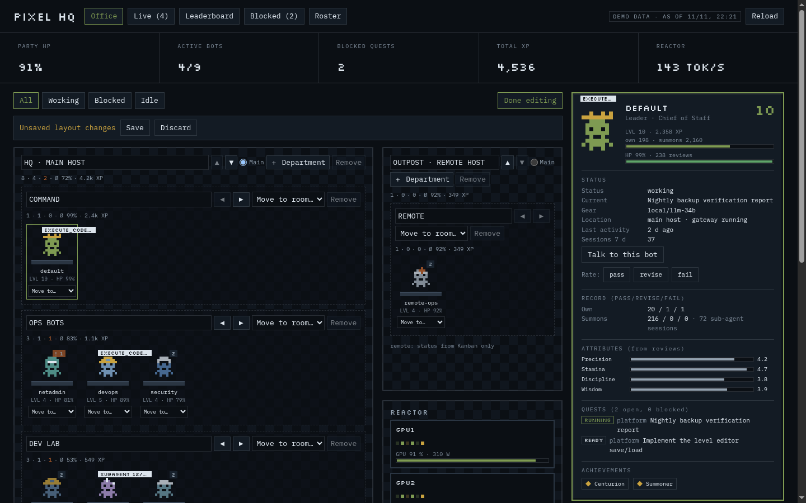
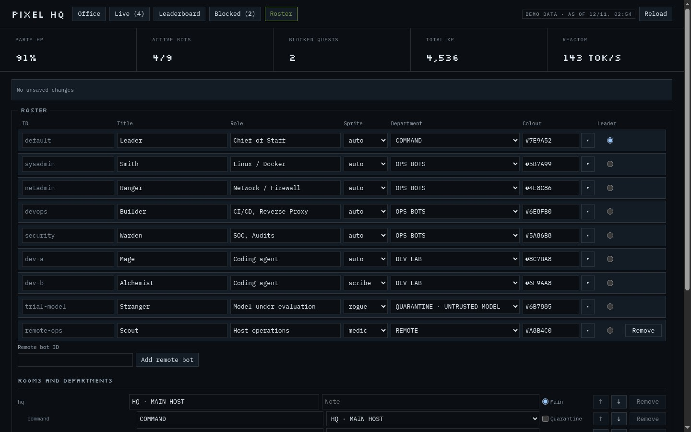
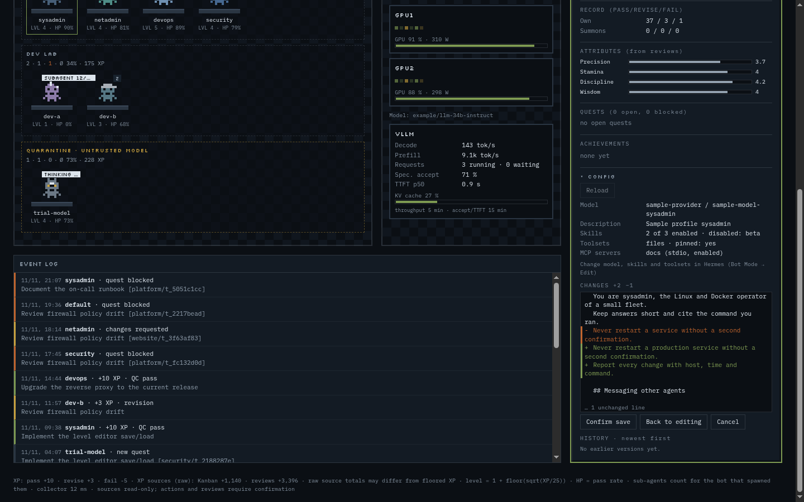

# Pixel HQ — a gamified HQ for your Hermes bot fleet

## What it is

Pixel HQ is a [Hermes Agent](https://github.com/NousResearch/hermes-agent) desktop plugin that turns your
fleet of profiles into a pixel-art headquarters. Each bot has a sprite at a desk, **XP and levels** from
Kanban outcomes and quality reviews, **HP** from its pass rate, and a live view of its current work.
Blocked cards have a triage board; optional GPU/LLM metrics appear in the **reactor**.

Most data is a read-only mirror of what Hermes already has. Kanban actions, reviews, roster saves and
triage chats are explicit operations; see [What it reads and writes](#what-it-reads-and-writes-disclosure).



*22-second highlight of the 1.0.0 UI (synthetic data); the screenshots below show 1.3.0. Full 57-second demo: [1080p](https://github.com/W4-NERF/pixel-hq/releases/download/v1.0.0/pixel-hq-demo.mp4) · [720p](https://github.com/W4-NERF/pixel-hq/releases/download/v1.0.0/pixel-hq-demo-720p.mp4). These show the 1.0.0 UI; see [`docs/video/`](docs/video/README.md) to re-render them.*

## Install

Requires Hermes **0.22.2 or later** (see [`plugin.yaml`](plugin.yaml)). Install from the plugin catalog:

```bash
hermes plugins install pixel-hq
hermes plugins enable pixel-hq
hermes gateway restart
```

Alternatively, install from the repository with `hermes plugins install W4-NERF/pixel-hq`.
**Restart the Hermes gateway**, not just the Desktop app: backend routes mount when the gateway starts.
Then open **Pixel HQ** in the sidebar or via ⌘K → *Open Pixel HQ*.

If you use profiles, enable the plugin in the root Hermes home (where the desktop backend runs) and in
any profile that should see it: `hermes -p <profile> plugins enable pixel-hq`.

## Platforms

Versions reach the plugin catalog through a reviewed SHA-bump PR, so the catalog can lag behind this
repository. As of **2026-11-12** the catalog lists **1.1.2**; 1.3.0 has been submitted.

| Platform | Status |
|---|---|
| Linux | Developed and tested here. |
| Windows (native Hermes) | Use **1.1.2 or later**: earlier versions check whether the gateway is alive with a call that, according to the Python documentation, terminates the process on Windows (not reproduced). WSL is **not** required: on a clean Windows 11 Pro (build 26200) with *Windows Subsystem for Linux* and *Virtual Machine Platform* disabled, Hermes 0.23.1 and Pixel HQ 1.1.2 installed natively, the plugin route answered with HTTP 200, process-creation auditing recorded no start of `wsl.exe` or `wslhost.exe`, and both features stayed disabled (2026-11-11). The only `bash.exe` starts came from the Git for Windows installer. One earlier report from a machine without WSL saw WSL being installed during setup; that did not reproduce on the clean machine and its trigger is unknown. The Desktop app itself was not part of that test. |
| macOS | Not tested. |

## How XP is earned

XP does not require a review ledger: Kanban outcomes are scored automatically by default. Each event is
joined to the card's assignee, and each `(board, event id)` is counted once per snapshot. Optional reviews
from the UI, the `pixelhq_review` tool and a legacy JSONL ledger add to the same scoring model.

| Kanban event or review | Verdict | XP (default) |
|---|---|---|
| Kanban `completed` | pass | +10 |
| Kanban `changes_requested` | revise | +3 |
| Kanban `gave_up` or `timed_out` | fail | -5 |
| Kanban `suspected_hallucinated_references` | fail; also counts as a Mirage | -5 |
| Review `pass` | pass | +10 |
| Review `revise` | revise | +3 |
| Review `fail` | fail | -5 |
| Kanban `protocol_violation` | No XP verdict; feeds Discipline | 0 |
| Self-review (`reviewer` equals the rated `agent`) | Excluded from scoring | 0 |

The weights are `xp_pass`, `xp_revise` and `xp_fail` in [Settings](#settings). `kanban_xp: false` disables
the Kanban source; `exclude_boards` excludes boards from both views and XP. Sources are recomputed from
scratch, so refreshing does not award the same event again. A completed card and a separate review are
two inputs, not one deduplicated verdict.

**Self-reviews** compare `reviewer` with the **rated agent before helper attribution**, not the bot receiving
XP. They count in `selfReviews` and remain flagged in the event log, but add no XP, HP, attributes or
`lastQc` update. An orchestrator reviewing its helper is not a self-review: the helper's `parent` receives
summon XP. Without `parent`, helper ids beginning with `subagent`, `delegate_task`, `claude-code-cli`,
`opencode`, `codex`, `cron:` or `<orchestrator>-subagent` credit `orchestrator_profile`; `a+b` credits `a`.

| Number | Rule |
|---|---|
| XP | Sum signed contributions across both sources separately for own work and summons; floor each bucket at zero, then add them. |
| Raw source XP | `xpBySource.kanban` and `xpBySource.reviews` remain signed; their sum can differ from floored XP. |
| Level | `1 + floor(sqrt(XP / 25))`; no outcomes means level 1. |
| HP | Rounded `100 × pass / (pass + revise + fail)` across both sources; unknown when there are no outcomes. |
| Achievements | Centurion (100+ passes), Clean record, Summoner, Mirage, Gridlock and Battered. |

**Where attributes come from** (Precision / Stamina / Discipline / Wisdom, on a 1–5 scale):

| Source, in priority order | Attribute inputs |
|---|---|
| Reviews with dimension scores | Averages of `correctness` / `completeness` / `format` / `safety`; shown as “from reviews”. Legacy `scores` or flat dimension keys are also accepted. |
| Otherwise, at least 3 Kanban completions | Derived from hallucinated-reference events / completed-vs-failed outcomes / protocol violations per claimed run / revision requests; clamped to 1–5, one decimal; shown as “from Kanban”. |
| Neither | Unknown attributes, not invented scores. |

A review is one JSON object per line, with required `agent` and `verdict` (`pass`, `revise` or `fail`),
optional `dims` (the four scores, 1–5), `parent`, `reviewer`, `source`, `ts` and `ref` (field reference:
[`docs/ledger.md`](docs/ledger.md)). Missing ledgers are fine; malformed lines produce warnings and unknown verdicts are skipped. Configure an existing ledger
with `legacy_ledger_path`; it remains read-only.

## The views

| Office | Live |
|---|---|
|  |  |
| **Leaderboard** | **Blocked** |
|  |  |
| **Edit layout** (a bot moved, not yet saved) | **Roster** |
|  |  |
| **Config** (SOUL change, preview before saving) | |
|  | |

These screenshots use synthetic data and show the 1.3.0 UI.

- **Office** — rooms and departments from your roster, a sprite per bot, current-step speech bubbles,
  character cards (level, XP, HP, attributes, quests, achievements) and the event log. **Talk to this bot**
  opens a new chat; remote bots instead show “runs on another host”. The reactor panel shows configured
  GPU utilisation/power (DCGM) and serving metrics: decode/prefill tok/s, running/waiting requests,
  KV-cache, speculative-decoding acceptance and TTFT.
- **Live** — active sessions, current step, last tool call and argument, token/cost counters, sub-agents
  nested under their parent and running Kanban cards with heartbeat age. No progress for 5 minutes marks
  a step stale. Live data is polled every 10 seconds while the page is open. **Open** also works for
  sub-agent rows; **Ask for status** on stale sessions prepares a composer draft without sending it or
  overwriting an existing draft. You press Enter to send.
- **Leaderboard** — rank by level, XP, HP or blocked cards; pass/revise/fail record, status, current quest
  and model.
- **Blocked** — cards across boards grouped as *waiting for you*, *technically stuck*, *stale*, *no
  reason* and *waiting upstream*, with reason, age, last comment and upstream cards. Available actions
  depend on the category: **Answer & unblock**, **Retry**, **Comment**, **Archive** (workspace backed up
  first). **Triage run** opens a new orchestrator chat with the selected card keys; it does not change the
  selected cards by itself.
- **Roster** — edit bot roles, colours, sprite choices and placement; **Save** or **Reset to generated**.
  Available inside Desktop; standalone controls require `?actions=1` and have no backend host there.

**Rate** is available on Live session rows (not sub-agents) and on Office character cards; confirmation
and storage are described in the [disclosure](#what-it-reads-and-writes-disclosure).

## Settings

Open **Settings → Plugins → Pixel HQ** in Desktop. Hermes stores the 19 optional settings under
`plugins.entries.pixel-hq.settings` in its `config.yaml`, outside the plugin so updates do not overwrite
them. The table is generated from [`plugin.yaml`](plugin.yaml) by `python3 tools/settings_table.py`;
`tests/test_readme_settings.py` checks it against the tool's output. Defaults below use JSON notation.

<!-- settings-table:start -->
| Key | Type | Default | Meaning |
|---|---|---|---|
| `locale` | `str` | `"en-GB"` | BCP 47 locale used to format numbers and dates. |
| `timezone` | `str` | `"UTC"` | IANA timezone used for clocks and dates. |
| `theme_label` | `str` | `"PIXEL HQ"` | Title displayed in the headquarters header. |
| `appearance` | `str` | `"auto"` | Appearance: auto follows the host theme; dark or light forces that palette. |
| `operator_name` | `str` | `"operator"` | Operator name used to attribute comments and reviews from the UI. |
| `orchestrator_profile` | `str` | `"default"` | Profile that receives unattributed helper XP and triage briefings. |
| `reviews_path` | `str` | `""` | Review JSONL path, or empty to use plugin-data/pixel-hq/reviews.jsonl under the root Hermes home. |
| `legacy_ledger_path` | `str` | `""` | Optional path to an older quality ledger that is read without modification. |
| `kanban_xp` | `bool` | `true` | Award XP for Kanban outcomes in addition to reviews. |
| `xp_pass` | `int` | `10` | XP contribution for each passed review or completed Kanban task. |
| `xp_revise` | `int` | `3` | XP contribution for each revision requested by a review or Kanban event. |
| `xp_fail` | `int` | `-5` | XP contribution for each failed review or failed Kanban outcome. |
| `stale_days` | `int` | `14` | Number of blocked days after which a card is considered stale. |
| `exclude_boards` | `list` | `[]` | Kanban board slugs excluded from all views and XP calculations. |
| `needs_input_keywords` | `list` | `["approval", "approve", "decision", "sign-off", "gate", "waiting for", "go"]` | Case-insensitive keywords that classify blocked cards as waiting for operator input. |
| `prometheus_url` | `str` | `""` | Prometheus base URL for reactor metrics, or empty to disable metric requests. |
| `metrics_prefix` | `str` | `"vllm"` | Serving metric family prefix used in Prometheus queries. |
| `model_endpoint` | `str` | `""` | OpenAI-compatible base URL for model discovery, or empty to disable model requests. |
| `node_aliases` | `dict` | `{}` | Mapping from Prometheus instance labels to reactor display names. |
<!-- settings-table:end -->

For headless setups, copy [`pixelhq/config.example.json`](pixelhq/config.example.json) to
`~/.hermes/plugin-data/pixel-hq/config.json` and adjust only the keys you need. With a custom
`HERMES_HOME`, use its root `plugin-data/pixel-hq/` directory; a home under `profiles/<profile>/` is
unwrapped to the root. The in-repository example files are not loaded automatically.

Precedence is **defaults < config.json < Hermes plugin settings**. Each saved Hermes key replaces the
file value, including `false`, `0`, empty strings, lists and dictionaries. `cfg.settingsSource` is
`hermes` when non-empty Hermes settings apply, otherwise `file` for a successfully read settings file or
`defaults`. Invalid JSON falls back to defaults, still overridden by Hermes; `cfg.configError` and footer
warnings explain errors. Values that cannot be coerced to the schema type fall back to their defaults.

Legacy nested `xp` and `gpu` blocks in `config.json` still work; an explicit flat key wins over its
nested equivalent. `ledger_path` is accepted as an alias for `legacy_ledger_path`, unless the flat key is
present. Relative ledger paths resolve against `<root Hermes home>/plugin-data/pixel-hq/`, never the
server's working directory. Absolute paths are a deliberate operator choice and may write outside
plugin-data; ledger symlinks are refused on write, so configure the real file. Leave both endpoints empty
for no network requests. `appearance: auto` follows the host theme, falling back to dark; `dark` and
`light` force a palette. Standalone `?mode=light` or `?mode=dark` overrides it.

Settings and roster changes apply on the next uncached refresh; they do not require a gateway restart.

## Roster

Without `roster.json`, Pixel HQ generates **HEADQUARTERS** with **COMMAND** and **CREW** from your
profiles. `orchestrator_profile` leads COMMAND; the others join CREW. The first-run banner's **Customise
roster** button opens the editor. Its **Dismiss** lasts for the page load only.

Save the editor, or copy [`pixelhq/roster.example.json`](pixelhq/roster.example.json) to
`~/.hermes/plugin-data/pixel-hq/roster.json` (the root Hermes home, as for settings). Profiles missing from
a custom roster appear automatically as **Recruits**. Non-remote entries for missing profiles are dropped
with a warning; `remote: true` keeps a bot without local session data, using Kanban status instead.

- **Rooms** describe locations. JSON uses `rooms[]` with `id`, `label`, exactly one `main` room, optional
  `note`, and nested `zones[]`.
- **Departments** are the `zones[]` entries (`id`, `label`, optional `quarantine`). A bot's `zone` selects
  its department. The file keys remain `rooms` / `zones` for existing rosters.
- **Bots** use `id` (profile name), `cls` (role), `title`, `zone`, `color` (`#rrggbb`) and optional `loc`,
  `leader`, `remote`, `sprite`. At most one bot wears the leader crown.
- **Sprites**: `default`, `wizard`, `knight`, `engineer`, `scout`, `medic`, `scribe`, `rogue`. An explicit
  `sprite` wins; otherwise role/title/id keywords choose a variant, then a stable id hash is the fallback.
  The leader crown replaces headgear; quarantine eyes stay.

### Departments

Rooms are locations above departments, and each bot belongs to exactly one department. A profile that is not
in the roster is placed in the first department of the main room; if the main room has no department, in the
first department in file order. A department that does not exist is never assigned. A `roster.json` without
any department is ignored with a warning and the generated default applies.

**Edit layout** (Office floor, inside the Desktop app; the standalone page offers it only with `?actions=1`)
switches the floor into edit mode:

- **Drag and drop**: press a bot's desk, move more than 4 px and release over a department to move the bot
  there. Releasing elsewhere, **Esc**, a cancelled pointer or a released button cancels the drag and changes
  nothing; only the pointer that started the drag can cancel it. Less movement stays a click.
- **Move to…**: the select on each desk does the same without dragging.
- Room and department controls on the floor: add, rename, move, reorder, set the main room, remove. A room
  can be removed only when it is empty and not the main room; a department only when no bot is in it. At most
  8 rooms, 24 departments and 200 bots.
- The Roster tab edits the same draft, including its department select. Nothing is written until **Save**;
  **Discard** (two clicks) returns to the saved roster. The bar has one fixed height in all its states
  (**No unsaved changes**, **Unsaved layout changes** with **Save** and **Discard**, **Saving roster …**, the
  result line), so nothing below it moves. The Roster tab always shows it, the floor while edit mode is on;
  after leaving edit mode the floor shows it only while unsaved changes or a result are pending. The bar
  reads **Unsaved layout changes** exactly while the draft differs from the last loaded or saved roster, so
  undoing a change by hand returns it to **No unsaved changes**. While a Save is running, edits are locked.

Department headers show five numbers, room headers the same numbers for all their departments:

| Number | Meaning |
| --- | --- |
| Members | bots in the department |
| Active | members working right now (live status `running`) |
| Blocked | Kanban cards in the Blocked tab that are assigned to a member |
| Ø HP | mean of the members' HP values, rounded; `–` when none has a value |
| XP | sum of the members' XP (shown compact, e.g. `1.2k`; the tooltip has the full number) |

In edit mode the numbers follow the unsaved draft, so a move changes both departments immediately.
Layout editing was verified in the Hermes Desktop app on Linux (drag and drop, two-click Discard, Save and
Reload, the unsaved bar), with offline Python tests and the Node DOM harness, and by hand in Chromium with
the page in a `sandbox="allow-scripts"` iframe. Touch input has not been verified.

### Saving and validation

Only **Save** writes the roster. It uses a temporary file plus atomic replacement and keeps one previous
generation as `roster.json.bak`. **Reset to generated** is a two-click action that moves the current file
to the backup. The request cannot choose another path. Save and reset refuse non-regular files, including
symlinks, at either the roster or backup path. Unknown schema keys are dropped; supported fields such as
`note`, `quarantine`, `loc` and `remote` survive an unmodified save.

Room/department ids allow 1–64 ASCII letters, digits, `_` and `-`; bot ids also allow `.`. Labels, roles,
titles and location text have a 40-character limit; room notes allow 80. Text rejects control or
bidi-override characters. A local bot must refer to an existing profile and every bot to an existing
department. Invalid saves return an inline error without writing.

## Bot configuration

Every character card in the Office has a **Config** section, collapsed by default. Opening it asks Hermes
for that bot's profile once (**Reload** asks again) and shows:

- **Read-only facts:** model `provider / default`, description, skills (enabled count and the disabled
  names), toolsets (enabled names, pinned yes/no) and MCP servers (name, transport, enabled). Lists
  collapse after 12 entries (“+N more”). Model, skills and toolsets are changed in Hermes itself
  (Bot Mode → Edit), not here.
- **SOUL editor:** the bot's `SOUL.md` in a text area. **Edit** → **Preview changes** shows a line diff
  (added and removed lines, unchanged context collapsed to 3 lines, at most 400 diff lines) → **Confirm
  save** needs a second click. **Back to editing** keeps the draft; **Cancel** drops it. Unchanged text
  has no Save. The text is stored as typed (no trimming or re-formatting); line endings are normalised to
  `\n`. Limits: 64 KiB of UTF-8; control characters other than tab and line break are rejected with an
  inline message. If the loaded SOUL has a `## Messaging other agents` heading and the draft does not,
  the preview warns that the Bot Mode messaging section was removed; saving stays possible.
- **History:** the previous SOULs of this bot, newest first (time and first line). **Preview** shows the
  diff from the current SOUL to the chosen version; **Confirm restore** (second click) saves it like any
  other edit, so the version it replaces is kept as well. The newest 10 versions per bot are kept.

**Save steps** (the same for an edit and a restore, one request id): (1) read the profile again — if the
SOUL changed since you opened it, nothing is written and the card says so (**Reload** keeps your text and
compares it with the current version, the editor itself is never replaced under the cursor); (2) store the *current* SOUL in the history — if that fails,
nothing is written; (3) write the new SOUL through Hermes; (4) read it back and compare. The result is
one of *saved*, *saved but the read-back differs*, *conflict*, *not written*, *error* or *unsupported*.

**Where the data comes from.** Hermes' own profile-editor calls (`profiles.describe`, `profiles.configure`),
the same ones Bot Mode's editor uses. The plugin never reads or writes profile files for this, and it
never shows raw `config.yaml`, `.env`, `auth.json` or memory files. A bot that runs on another host is
reachable only when the Desktop app has exactly one connection to it; otherwise the card says “Not
reachable from this Desktop” (none) or that more than one connection offers the bot (nothing is called).
A Hermes version without these calls shows “This Hermes version has no profile editor API”. Saving never
submits a prompt and never touches any other profile setting.

On the standalone page the Config section shows synthetic demo data, read-only; editing and the history
need Hermes Desktop.

## What it reads and writes (disclosure)

**Rate**: choose **pass**, **revise** or **fail**, adjust the four 1–5 scores (default 4) and reference,
then **Confirm** or **Cancel**. Only Confirm appends a UI review. The reference starts with the
session/current quest title (80 characters); edits allow up to 200. Results appear inline, and a
successful review refreshes XP and attributes. Desktop exposes the controls; `?actions=1` exposes them
on a standalone page for demos, but submits there resolve as “standalone page: no host, nothing was
sent”. The footer reports signed raw Kanban/review XP and source warnings.

- **Reads** (read-only, local): profile directories, their `config.yaml`, `profile.yaml`, `gateway.pid`
  and `state.db` (sessions, last activity, last tool call); `kanban/boards/*/kanban.db` below the root
  Hermes home (cards, events, comments, dependencies); settings, roster and quality ledgers. Profile
  discovery reads directories directly, without running `hermes profile list`.
- **Profile data** (Desktop only, read): the Config section asks Hermes' `profiles.describe` for the SOUL,
  the model pin, skills, toolsets and MCP server names of a bot when you open it. Remote bots are asked only
  through a Desktop connection that Hermes itself provides. Nothing else of a profile is read this way.
- **Network**: only the Prometheus and model endpoints you configure, none by default. The new features
  add no network call by the plugin; their requests go through the Hermes Desktop connection.
- **Kanban writes**: only on your confirmed action, through the official CLI
  `hermes kanban --board … comment|unblock|archive`, never by database writes and never `archive --rm`.
  Each action is logged in `var/actions.jsonl` in the plugin checkout; archiving first copies the card's
  workspace to `var/archived-workspaces/`.
- **Reviews**: confirmed ratings append to `reviews_path` (default
  `~/.hermes/plugin-data/pixel-hq/reviews.jsonl`, created when missing) with UTC time, `source: "ui"` and
  `operator_name` as reviewer. The `pixelhq_review` tool appends submitted reviews with `source: "tool"`
  and the calling profile as reviewer. Hermes databases and the optional legacy ledger stay read-only.
  Retried UI review drafts reuse a request id; a match in the ledger's last 64 KiB returns “Review
  already recorded.” instead of appending again.
- **Roster writes**: only explicit Save or Reset, to `plugin-data/pixel-hq/roster.json` and its
  one-generation backup under the root Hermes home, as described above.
- **SOUL writes**: only through Hermes' `profiles.configure`, only after **Preview changes** and a second
  click (**Confirm save** / **Confirm restore**), and only the `soul` field. Before each write the current
  SOUL is stored verbatim in `plugin-data/pixel-hq/soul-history/<source>/<bot>/` under the root Hermes home (one
  `.md` file per version named with the time and the full request id, mode 0600, the newest 10 per bot kept, older
  ones deleted; `soul-history/` and the directories below it must be real directories, while `plugin-data/` and
  `plugin-data/pixel-hq/` may be links; the key is derived by
  the backend from the connection and bot id, never from a path in a request). This is the only new
  write path of the plugin. It never writes the SOUL file directly.
- **Update check**: the plugin list is read through Hermes' `plugins.manage` (`list`) to find out whether
  Pixel HQ itself has an update — at page load and then at most every 6 hours (every outcome, an error included,
  is kept for those 6 hours, so reopening the page does not ask again). Only the row for
  `pixel-hq` is used. The plugin never updates itself; see [Updating](#updating).
- **Triage run**: creates a new orchestrator chat and submits a briefing containing card keys and one
  selection sentence built by the host from fixed strings, category, validated board id and stale
  threshold — never card text or page-supplied prose. It does not submit text into an existing session.
- **Session actions**: Open navigates to a session; Talk opens a new chat; Ask for status prepares and
  focuses a draft only when empty. These actions do not submit a prompt. Missing Desktop capabilities
  return “not supported by this Hermes Desktop version”.
- **Remote bots** are included only through Desktop connections (see [Bot configuration](#bot-configuration)).
- No telemetry, self-update or credentials. Untrusted card/session titles, tool arguments and review
  references are clipped and escaped before rendering. The UI runs in a scripts-only sandboxed iframe;
  page-local drafts and dismissals are not browser storage.

## Updating

After updating Pixel HQ, restart the Hermes gateway (`hermes gateway restart`) to finish the update.
The backend loads its Python modules and page assets once per gateway process. Restarting Desktop
alone does not reload them. When the installed and loaded manifest versions differ, the footer says:

> Pixel HQ &lt;installed&gt; is installed but &lt;loaded&gt; is still running — restart the Hermes gateway
> (`hermes gateway restart`) to finish the update.

**Update available.** When Hermes reports a newer catalog version (or an update target) for Pixel HQ, the
header shows an **Update available** button. It opens a panel with the installed and the available version
(and short commit ids), two steps — update in Hermes (Capabilities → Plugins) or run
`hermes plugins update pixel-hq`, then restart the gateway — and an **Open Plugins** button where the Desktop
app supports navigation. **Esc** or **Close** closes the panel. The plugin never updates itself. In every
other state the footer keeps one quiet line, for example “Update check: up to date (catalog 1.3.0)” or
“Update check: not available for this installation” (also for installs that are not from the catalog and have
no update target); a failed check is a footer line, never a pop-up. Hermes runs its own update check
(default every 24 hours); the page asks at load and at most every 6 hours. The standalone page has no
update notice.

Settings and roster files live outside the plugin checkout and survive updates. See
[`CHANGELOG.md`](CHANGELOG.md) for version history and verification limits.

## Troubleshooting

| Symptom | Check or action |
|---|---|
| Blank page or 502 | Enable Pixel HQ in the root Hermes home, then restart the **gateway**, not just Desktop. Check gateway logs for `Failed to load plugin pixel-hq API routes`; a module-load failure intentionally prevents the backend from mounting. If a control reports a missing Desktop capability, that API is not supported by the running Desktop version. |
| No bots | Check the root `HERMES_HOME` and footer warnings. Profiles under `profiles/` need `config.yaml` or `profile.yaml`; names starting with `_` or `.` are skipped. A roster entry without a local profile needs `remote: true`. Missing or malformed rosters fall back to a generated roster. |
| No XP | Kanban needs scored events joined to a known assignee, `kanban_xp: true` and a board not in `exclude_boards`. Review-only setups need valid `agent`/`verdict` records at the configured path. Self-reviews give no XP; negative buckets floor to zero. No outcomes means level 1 and unknown HP, not a collection error. Read the raw source totals and warnings in the footer. |
| Review ledger is a symlink | Set `reviews_path` to the real file, not its symlink. Writes refuse the link; do not work around the guard by retrying. |
| `roster.json is not a regular file` | Check both `roster.json` and `roster.json.bak` in root plugin-data. Save/Reset refuse symlinks, directories and other special files; back up your data and use regular files at both locations. |
| WSL offered on Windows | Use 1.1.2 or later. Pixel HQ does not call WSL, and a clean Windows 11 machine without WSL ran Hermes and Pixel HQ without starting it (see [Platforms](#platforms)). The trigger in the one earlier report is unknown. |
| `hermes plugins install` fails on Windows with `CRYPT_E_REVOCATION_OFFLINE` | Git for Windows could not reach the certificate revocation servers, which use plain HTTP (port 80). Allow that traffic from the machine, then retry. This is a network restriction, not specific to Pixel HQ. |
| Installed version differs from running version | Follow the stale-backend notice: `hermes gateway restart`. A settings refresh or reopening Desktop is not a code reload. |

## Development

Python 3.11+ and Node 22+ are needed for the offline tests; `python3 -m pip install -r requirements-dev.txt`
installs pytest, PyYAML, FastAPI, httpx and Ruff. The UI is plain HTML/CSS/JS, inlined by `page.py` with no
build step. See [`CONTRIBUTING.md`](CONTRIBUTING.md) for conventions and the checks CI runs. To link a
checkout for Desktop development:

```bash
ln -s ~/src/pixel-hq ~/.hermes/plugins/pixel-hq
hermes plugins enable pixel-hq
hermes plugins validate ~/src/pixel-hq --install-deps
hermes gateway restart
```

Desktop hot-reloads its plugin UI; backend modules and the embedded page assets require a gateway
restart. Use a writable disk-backed `TMPDIR` with enough space; include your supplied Python toolchain
and repository root in `PYTHONPATH` if needed. From the repository root:

```bash
python3 -m ruff check .
python3 -m pytest -q --basetemp="$TMPDIR/bt-pixel-hq"
python3 tools/jscheck.py
python3 tools/jslint.py
python3 tools/funclen.py
python3 tools/contrast.py
python3 tools/settings_table.py
python3 pixelhq/render.py --demo
```

`jscheck.py` runs Node syntax checks; `jslint.py` limits UI line and function length; `funclen.py` rejects
Python functions over 80 physical lines;
`contrast.py` checks both palettes. `settings_table.py` prints the table between the README's
`settings-table` markers; paste its output there after editing the manifest. The README regression test
fails on drift. The demo command writes `dist/pixel-hq.html` with `"demo": true`; open that file locally
to explore synthetic data without a fleet. Without `--demo`, the renderer reads your real local data.

Tests build invented SQLite/JSON fixtures and deny sockets and real CLI actions; Node DOM/bridge tests
are not verification inside a running Desktop app. Test real Kanban actions only against a dedicated
sandbox board whose cards have no assignee, and list that board in `exclude_boards`.

### License

MIT — see [`LICENSE`](LICENSE). Bundled IBM Plex Mono and Silkscreen fonts use the SIL Open Font License
1.1 (`pixelhq/fonts/OFL-*.txt`).
